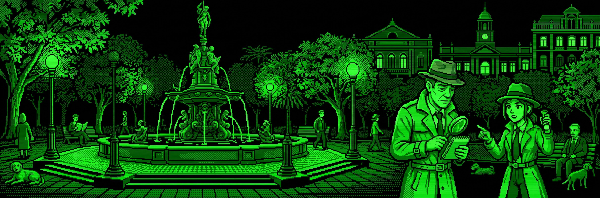
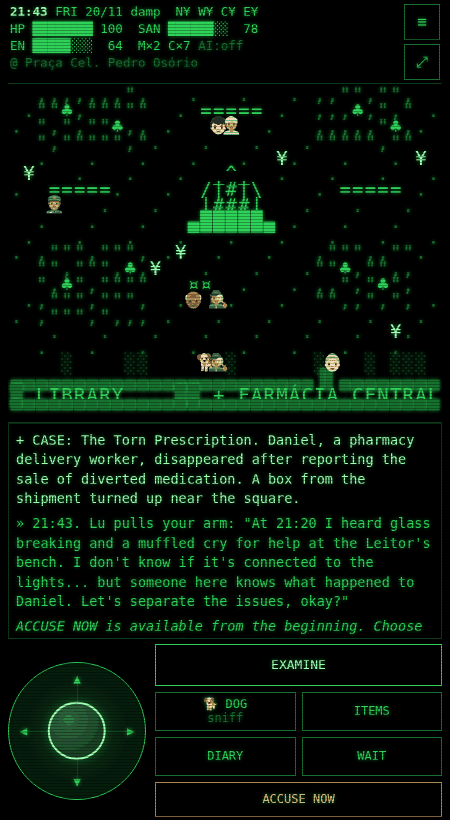

# Mystery in the Square

**[Play in English](https://claudiodrews.github.io/mystery-in-the-square/#en)** · [Jogar em português](https://claudiodrews.github.io/mystery-in-the-square/#pt-BR) · [Português (Brasil)](README.pt-BR.md)

Night falls over Praça Coronel Pedro Osório, in Pelotas, southern Brazil. A crime needs solving, and the streetlights are going out one by one.

**When the last light goes out, the case goes cold.**

## The square is going dark

You are Cláudio. You have your dog Christopher, who smells what no one else notices, and Lu, who tells you when you are fooling yourself.

Question suspects, piece together conflicting stories and collect evidence before the square goes dark. Every minute matters, testimonies may contradict each other, and a wrong accusation can cost you dearly.

## How a case unfolds

- **Explore the square.** Talk to whoever is nearby, examine your surroundings and listen in on conversations.
- **Follow Christopher.** Let him sniff out hidden clues and scents the eye misses.
- **Interrogate.** Suspects remember, contradict each other, withhold information and hide motives.
- **Build your case.** Collect evidence and organize it on your deduction board.
- **Accuse before the blackout.** Consult Lu when you need a second perspective, then accuse when you are ready. If you wait too long, the dark decides for you.

## No two cases play the same

- Procedurally generated mysteries across six original scenarios.
- Characters with distinct personalities, memories and social dynamics. What they tell you depends on what they saw, who they trust and what they want to hide.
- Normal and Advanced modes, progressive blackouts and resource management. The deeper you go, the less light and time you have.
- Retro green terminal aesthetic, emoji map and mobile-friendly touch controls.
- English and Brazilian Portuguese. The Portuguese dialogue features regional slang and expressions from Pelotas.

## Play now

**No installation. No account. No API key required.**

[Open the game in your browser](https://claudiodrews.github.io/mystery-in-the-square/#en) and start your first case. You can also [download the repository](https://github.com/ClaudioDrews/mystery-in-the-square/archive/refs/heads/main.zip), extract it and open `index.html` to play locally.

## Optional AI

Want more flexible dialogue, new mysteries for your library and epilogues? Open AI Settings, enter your [OpenRouter](https://openrouter.ai/) API key and choose a model.

The game engine determines the facts, evidence and solution of each case, independently of the language model.

Your key stays in your browser's local storage. AI requests send dialogue and relevant game context to OpenRouter, so avoid entering sensitive information. Model usage may incur charges.

## Fictional setting

The game takes place in a real city, but its characters are fictionalized. All crimes, investigations, motives, accusations and outcomes are fictional and should not be interpreted as statements about real people or events.

## License: MIT, open by design

This game is [MIT licensed](LICENSE). That is deliberate.

You are free to fork it, study it, modify it and build on it. The core mechanics are already tested in a playable game: procedural mystery generation, interrogation with memory and social dynamics, evidence and deduction board, progressive blackouts and resource management, and optional AI for dialogue and new stories.

If you are making your own mystery, detective or narrative game, you do not need to start from zero. Explore how these systems work, reuse them, remix them, and contribute back with new scenarios, translations, mechanics or improvements.

**Open to play, open to learn from, open to build on.**

## For developers

Want to contribute, run tests or run the game locally? See the [development notes](docs/DEVELOPMENT.md).
