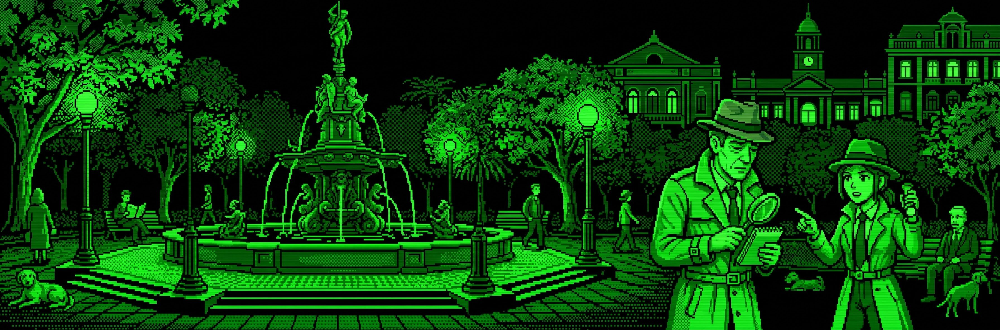

<p align="center"></p>

# Mistério na Praça

[English](README.md) · **[Jogar em português](https://claudiodrews.github.io/mystery-in-the-square/#pt-BR)** · [Play in English](https://claudiodrews.github.io/mystery-in-the-square/#en)

Cai a noite na Praça Coronel Pedro Osório, em Pelotas, no Rio Grande do Sul. Há um crime a desvendar, e os postes da praça estão se apagando um a um.

Assuma o papel de Cláudio, investigue com seu cachorro Christopher e discuta suas descobertas com Lu. Interrogue suspeitos, compare versões contraditórias e reúna pistas antes que a praça mergulhe na escuridão.

## Características

- Mistérios gerados proceduralmente a partir de seis histórias originais.
- Personagens com personalidades distintas, memória e dinâmica social.
- Coleta de pistas, interrogatórios e quadro de deduções.
- Modos Normal e Avançado, apagão progressivo e gerenciamento de recursos.
- Conversas, novos mistérios e epílogos com IA opcional.
- Estética retrô de terminal verde, mapa com emojis e controles táteis para celular.
- Português e inglês. Os diálogos em português incluem gírias e expressões regionais de Pelotas.

## Como jogar

Explore a praça, converse com os personagens próximos, use Christopher para farejar pistas e consulte o diário. Discuta suas hipóteses com Lu e acuse um suspeito quando estiver pronto.

É possível jogar sem chave de API. Para jogar localmente, baixe o repositório e abra `index.html` no navegador.

## IA opcional

Abra a **Configuração de IA**, informe sua chave de API do [OpenRouter](https://openrouter.ai/) e escolha um modelo. A IA permite conversas mais livres e a criação de novas histórias para a biblioteca de mistérios. Os fatos e as pistas de cada caso são definidos pelo motor do jogo.

A chave fica armazenada no navegador. As requisições de IA enviam diálogos e contexto relevante do jogo ao OpenRouter; evite inserir informações sensíveis. O uso dos modelos pode gerar custos.

## Desenvolvimento

Node.js 20 ou superior, sem dependências npm.

```sh
npm test
npm run build
python3 -m http.server 8000
```

Consulte as [notas de desenvolvimento](docs/DEVELOPMENT.md) para informações sobre arquitetura, localização e testes.

## Cenário ficcional

O jogo se passa em uma cidade real, mas seus personagens são ficcionalizados. Todos os crimes, investigações, motivos, acusações e desfechos são fictícios e não devem ser interpretados como afirmações sobre pessoas ou acontecimentos reais.

## Licença

[MIT](LICENSE)
